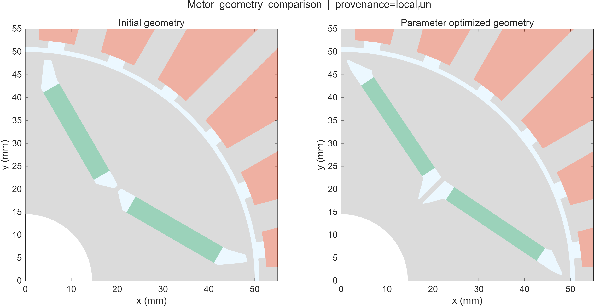
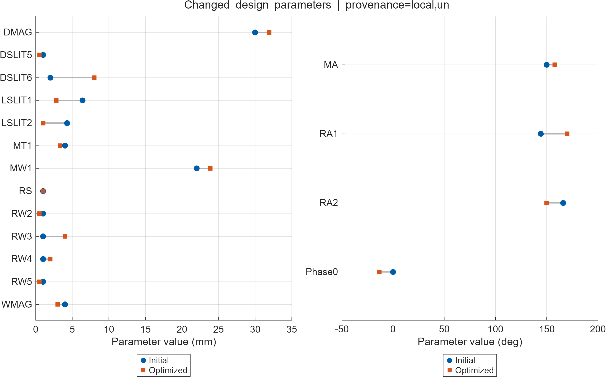
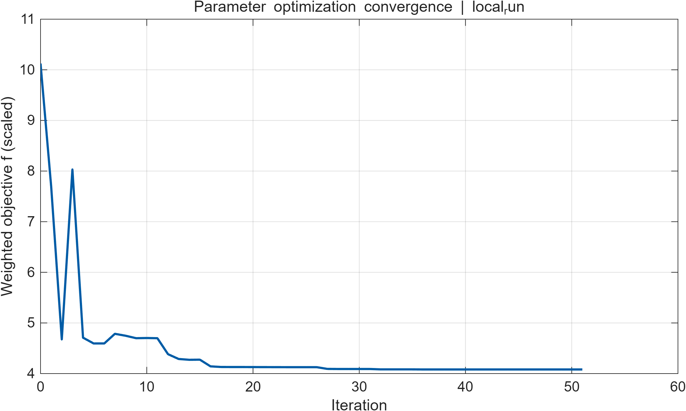
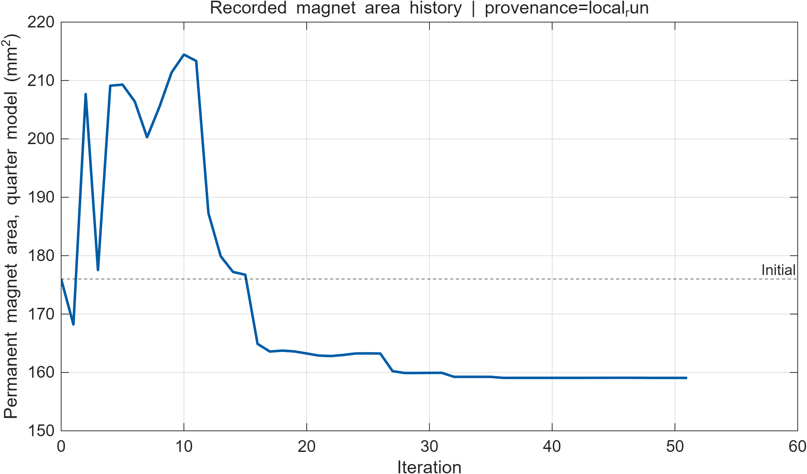
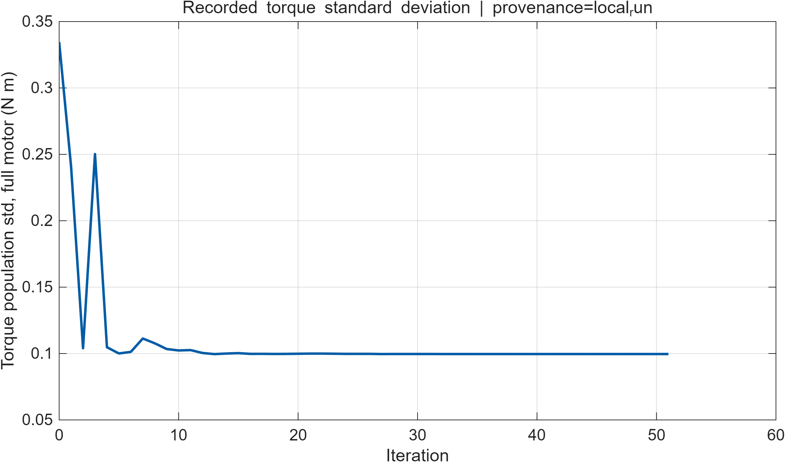
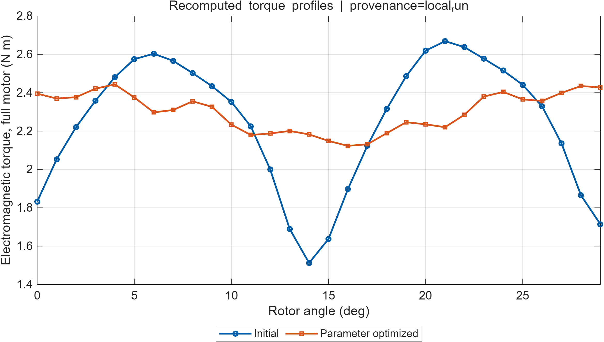

本次复现仅覆盖原论文的结构参数优化（Parameter Optimization）及初始、优化电机的统一性能评价。初始模型和完整参数优化均在本机 MATLAB R2025a 实际运行，终态设计已重新调用电磁场求解器评价。形状、顺序及联合优化已按用户要求取消，未启动；本报告不宣称复现原论文全部优化工作。

本机结果：四分之一模型永磁体面积降低 **9.62201%**，整机转矩总体标准差降低 **70.1576%**，平均转矩变化 **2.42299%**。参数优化完成 **51 次迭代**、**72 次函数评价**；优化器记录用时 **52.387 min**。最终整机平均转矩为 **2.30000010665 N·m**，满足源代码约束及容差要求。

数据口径：转矩统一为整机值（四分之一模型计算值乘 4），永磁体面积保留四分之一模型口径。所有本次计算、图表和迭代历史标记为 `local_run`；论文对照项标记为 `paper_reference`。未使用作者已有优化归档填补任何本次实算结果。

## 1 论文基本信息

论文题为 *Combined parameter and shape optimization of electric machines with isogeometric analysis*，作者为 Michael Wiesheu、Theodor Komann、Melina Merkel、Sebastian Schöps、Stefan Ulbrich 和 Idoia Cortes Garcia，发表于 *Optimization and Engineering*，26 卷，1011–1038 页（2025 年卷期，2024 年 9 月 21 日在线发表），DOI：[10.1007/s11081-024-09925-0](https://doi.org/10.1007/s11081-024-09925-0)。

论文提出使用等几何分析和几何灵敏度连接参数变化与 NURBS 控制点变化。本报告保留其中单独参数优化的原始模型：在平均转矩和几何约束下，减少永磁体用量及转矩波动。目标没有包含整机损耗或效率。

官方代码仓库为 [MichaelWiesheu/MotorOptimization](https://github.com/MichaelWiesheu/MotorOptimization)。固定版本为 `e61673e10d4a7f164b713fb744e19bb69973f7e9`。最初执行任务书来自用户仓库 main 分支，固定版本 `4745ca9783b4679ebffea3812763440323a9ef66`；当前执行范围以用户后续的“仅完成结构参数优化”指令为准。

代码遵循 GPL-3.0。几何来源为 JMAG-RT Motor Model Library，材料来源为 FEMM，保留官方 README 对相关第三方条款的说明。本次没有运行 Maxwell、JMAG、COMSOL 或 FEMM。

## 2 原论文结构参数优化方法

### 2.1 电磁模型和统一采样

研究对象为四极、24 槽、V 形内置永磁体同步电机。采用二维非线性静磁场模型，利用四分之一对称区域、反周期边界条件和气隙谐波耦合连接转子与定子。铁磁材料采用作者 MAT_M27 的非线性 B–H 数据与 pchip 插值；永磁体剩磁为 1 T。轴向长度为 35 mm，三相电流幅值 3 A，每相绕组定义使用 35 匝，极对数为 2。上述工况均直接取自官方入口与材料代码。

离散后的非线性场方程可写为

$$\mathbf e(\mathbf u,\mathbf p)=\mathbf K(\mathbf u,\mathbf p)\mathbf u-\mathbf b(\mathbf p)=\mathbf 0.$$

场解使用作者的牛顿迭代与线搜索。转矩按作者的耦合能量表达式计算；每个优化设计取转子角度 $0^\circ,1^\circ,\ldots,29^\circ$，共 $N=30$ 点。初始与终态独立评价保留官方 $0^\circ$–$30^\circ$、间隔 $0.25^\circ$ 的 121 点求解，再抽取相同的 30 个整数角度用于统计，不插值造数。

设四分之一模型转矩为 $T_q$，则整机转矩 $T=4T_q$。本报告使用总体标准差：

$$\overline T=\frac{1}{N}\sum_{k=1}^N T_k,\qquad \sigma_T=\sqrt{\frac{1}{N}\sum_{k=1}^N(T_k-\overline T)^2}.$$

计算实现为 `mean(T)` 和 `std(T,1)`。永磁体面积由最终 NURBS 几何两个磁体区域的面积直接求和，未从单个目标值反推性能。

### 2.2 设计变量及物理意义

官方入口包括 16 个几何变量和 1 个三相电流初相角 Phase0。Phase0 为电角度参数，不是几何尺寸；为保持原论文参数优化模型，仍与其余变量一起优化。参数名称和单位与源码对应，物理意义依据几何函数 point、epsilon、phi 等定义说明。

| 变量 | 物理意义 | 显示单位 |
|---|---|---|
| DMAG | 磁体内端沿极轴的定位分量 | mm |
| DSLIT5 | 内侧气隙槽第一定位距离 | mm |
| DSLIT6 | 内侧气隙槽第二定位距离 | mm |
| LSLIT1 | 外侧气隙槽第一边长度 | mm |
| LSLIT2 | 外侧气隙槽第二边长度 | mm |
| MT1 | 永磁体厚度 | mm |
| MW1 | 永磁体长边宽度 | mm |
| MA | V形磁体夹角参数 | deg |
| RA1 | 外侧槽第一边方向角参数 | deg |
| RA2 | 外侧槽第二边方向角参数 | deg |
| RS | 极轴附近气隙槽宽度 | mm |
| RW2 | 磁体外端第一延伸距离 | mm |
| RW3 | 磁体外端第二延伸距离 | mm |
| RW4 | 磁体内端第一延伸距离 | mm |
| RW5 | 磁体内端第二延伸距离 | mm |
| WMAG | 磁体内端垂直极轴的定位分量 | mm |
| Phase0 | 三相电流初相角 非几何变量 | deg |

### 2.3 目标函数和约束

参数优化目标为

$$\min_{\mathbf p}\ f(\mathbf p)=10^4 A_q(\mathbf p)+100\,\sigma_{T,q}(\mathbf p).$$

其中 $A_q$ 的单位为 m²，$\sigma_{T,q}$ 的单位为 N·m，二者均采用四分之一模型口径。参数优化不包含形状光滑性项。权重是作者用于数值缩放的固定权重，因此目标值应作为加权数值比较，不能等同于面积、平均转矩或效率。

平均转矩约束为

$$\overline T_q\geq \frac{2.3}{4}=0.575\ \mathrm{N\,m},\qquad \overline T\geq 2.3\ \mathrm{N\,m}.$$

作者在参数入口中将转矩不等式缩放为 $100(0.575-\overline T_q)\leq0$。另有变量上下界及九个几何不等式。设 $R=RD1/2$、$R_i=RD2/2$、$\delta=1.5$ mm、$r_f=RF=0.2$ mm，几何 point 向量使用源代码定义，约束原始距离表达式为

$$\begin{aligned}\tilde c_1&=\lVert\mathbf p_9\rVert-R+\delta,\\\tilde c_2&=\lVert\mathbf p_{14}\rVert-R+\delta,\\\tilde c_3&=-p_{14,y}+\delta/2,\\\tilde c_4&=-p_{9,y}+\delta/2,\\\tilde c_5&=\lVert\mathbf p_{15}\rVert-R+\delta,\\\tilde c_6&=-\lVert\mathbf p_{15}-\mathbf p_{14}\rVert+2r_f,\\\tilde c_7&=-\lVert\mathbf p_{12}-\mathbf p_{13}\rVert+2r_f,\\\tilde c_8&=R_i+2\delta-\lVert\mathbf p_8\rVert,\\\tilde c_9&=R_i+2\delta-\lVert\mathbf p_{13}\rVert.\end{aligned}$$

输入长度按米计算，源码实际返回 $c_i=100\tilde c_i$，要求 $c_i\leq0$。这些约束对应外侧铁桥、气隙槽及内孔邻域的几何限制；本次仅验证原代码约束，不据此声称完成机械强度、热或退磁安全认证。

### 2.4 求解算法

采用 MATLAB `fmincon` 的 interior-point 算法。几何参数通过 NURBS 控制点关系传播导数；电磁响应使用作者的解析/半解析灵敏度和伴随计算。变量按其上下界归一化到 $[0,1]$，目标和约束梯度均提供给求解器。

| 设置 | 原始配置 |
|---|---|
| MaxIterations | 300 |
| StepTolerance | 1e-8 |
| OptimalityTolerance | 1e-6 |
| ConstraintTolerance | 1e-6 |
| SpecifyObjectiveGradient / SpecifyConstraintGradient | true / true |
| ScaleProblem / HonorBounds | false / false |
| 优化角度 | 0:1:29 deg，共 30 点 |
| 转子/定子离散 | 细分 [4,4] / [3,3]；阶数均 [2,2] |
| 谐波设置 | 26 个；阶次 2,6,10,…,102 |
| 非线性场停止条件 | 残差平方范数 < 1e-6；最多 50 次牛顿迭代 |

## 3 MATLAB复现环境

MATLAB 实际版本为 `25.1.0.2943329 (R2025a)`。Optimization Toolbox、Curve Fitting Toolbox、Global Optimization Toolbox 均已安装，许可测试均返回 1；`fmincon`、`fit`、`ga` 的函数路径已核实。`ga` 不参与本次参数优化。GeoPDEs 与 NURBS Toolbox 使用仓库附带快照，没有下载替换版本。

计算设备为 AMD Ryzen 7 5800H（8 核 / 16 线程）、约 16 GB 物理内存的 Windows 主机。MATLAB 路径为 `F:/Program Files/MATLAB/R2025a/bin/matlab.exe`；环境检查时 E 盘剩余约 148 GB。完整证据保存在 `../results/logs/environment.log`、`../docs/ENVIRONMENT.md` 和 `../docs/commit.txt`。

上游主克隆保持原始源码及作者 results 归档，实际计算使用独立 worktree。主克隆原作者数据共核查 1373 个文件，SHA-256 检查全部一致。工作副本中的初始转矩文件由本次实算覆盖，但原始作者版本仍完整保存在主克隆。新增诊断仅保存 fmincon 输出和场求解残差，没有改变材料、方程、采样、目标、约束或优化器参数。

## 4 复现过程

### 4.1 初始建模和性能计算

使用 `results/opt_evaluations/eval_init.m` 建立初始几何、材料、边界、绕组和耦合关系，完成真实磁场计算并保存 121 个角度转矩。统一评价使用其中 30 个整数角度。初始求解及指标计算用时 **94.7743518 s**。用户缩减范围后直接复用已保存的 `baseline.mat`，没有重新求解初始电磁性能。

初始独立评价与优化器起点有一个应明确的源码差异：几何默认 RA1 为 **144.2°**，而 `opt_param.m` 将 RA1.Init 设为 **144°**。本次均原样保留。因此参数表同时列出“独立基线”和“优化起点”，避免将两者混为完全同一设计。优化器起点整机平均转矩为 2.24484488378 N·m，标准差为 0.334562215511 N·m；独立基线值见第 5 节。

### 4.2 参数优化执行和状态记录

完整运行 `results/opt_param/opt_param.m`。用户修改任务范围时该程序仍在运行，原进程持续完成计算，没有中断、重启、调参或缩短迭代；仅取消了原本等待参数阶段之后的三类优化。

每次优化回调保存迭代号、目标值、函数评价次数、一阶最优性、约束违反量、面积、转矩均值/标准差、30 点转矩、变量及耗时，并导出当步 NURBS 几何。所有原始回调记录保存在 `../results/data/optimizer_checkpoints/OptimizationHistory.mat`。本次共有 53 条回调记录：迭代 0 记录两次，迭代 1–51 各一次。原始记录全部保留；绘图对重复迭代号仅取首条，没有插值或平滑构造新数据。

| 执行信息 | 本次实际结果 |
|---|---|
| 总迭代数 | 51 |
| 函数评价次数 | 72 |
| 优化器历史记录耗时 | 3143.21746 s / 52.38696 min |
| 参数阶段总耗时（含初始化） | 3164.258294 s |
| 终态独立评价耗时 | 105.5786334 s |
| 最终目标函数值 | 4.081190164928 |
| 优化器起始目标值 | 10.12405538776 |
| exitflag | 2 |
| 最大约束违反量 | 0 |
| 一阶最优性 | 1.39505284088e-05 |

求解器原始退出说明：可能存在局部最小值。满足约束。

fmincon 已停止，因为当前步长小于
步长容差值并且在约束容差值范围内满足约束。

<停止条件详细信息>

优化已停止，因为 x 的所有元素的相对变化
小于 options.StepTolerance = 1.000000e-08，
并且相对最大约束违反值 0.000000e+00 小于 options.ConstraintTolerance = 1.000000e-06。

本次 exitflag=2，表示步长停止条件和可行性容差满足；不能将其解释为一阶最优性已达到 1e-6，更不能据此宣称全局最优。一阶最优性实际值已在上表保留。

这里的“优化器耗时”取最后一个回调的 TimeElapsed，与作者历史数据口径一致。阶段总耗时还包含模型初始化，MATLAB 启动耗时未计入两者。耗时比较仅反映本机单次运行，同期还进行了环境和图表准备，不构成受控性能基准，不作为算法速度优劣结论。

### 4.3 终态设计独立重算

从本次返回的设计变量与实际最终 NURBS 几何重新建立电机，使用最终 MA 和 Phase0 定义磁化方向及电流相位，调用原始非线性静磁求解器。转矩和面积分别由场解和几何重新获得，不依赖最终加权目标反算。

终态保留 121 点细角度原始数据和每点残差平方，最大值为 **9.53687437478e-07**，满足原停止条件。`../results/data/param_reevaluation_check.csv` 同时保存优化器缓存响应与独立重算结果，便于检查历史回调和最终设计是否一致。

## 5 优化结果

### 5.1 设计参数前后对比

下表长度统一显示为 mm，角度显示为 deg。Phase0 在求解模型中使用 rad，CSV 同时保存显示值与原生单位值，后续再计算应使用 `optimized_native`。RA1 的独立基线与优化器起点差异已单列。

| 变量 | 单位 | 独立基线 | 优化起点 | 下限 | 上限 | 最终值 |
|---|---|---|---|---|---|---|
| DMAG | mm | 30 | 30 | 20 | 40 | 31.9056227 |
| DSLIT5 | mm | 1 | 1 | 0.5 | 6 | 0.500037323 |
| DSLIT6 | mm | 2 | 2 | 1.5 | 8 | 7.99979723 |
| LSLIT1 | mm | 6.4 | 6.4 | 1 | 8 | 2.79628027 |
| LSLIT2 | mm | 4.3 | 4.3 | 1 | 8 | 1.00000427 |
| MT1 | mm | 4 | 4 | 1.5 | 10 | 3.33442566 |
| MW1 | mm | 22 | 22 | 10 | 27 | 23.8519741 |
| MA | deg | 150 | 150 | 100 | 160 | 157.838129 |
| RA1 | deg | 144.2 | 144 | 130 | 170 | 169.99992 |
| RA2 | deg | 166 | 166 | 150 | 179 | 150.000138 |
| RS | mm | 1 | 1 | 1 | 4 | 1.00000138 |
| RW2 | mm | 1 | 1 | 0.5 | 4 | 0.500002057 |
| RW3 | mm | 1 | 1 | 0.5 | 4 | 3.99998622 |
| RW4 | mm | 1 | 1 | 0.5 | 2 | 1.99634646 |
| RW5 | mm | 1 | 1 | 0.5 | 2 | 0.500029108 |
| WMAG | mm | 4 | 4 | 3 | 8 | 3.00000212 |
| Phase0 | deg | 0 | 0 | -20 | 20 | -13.4067217 |

按显示单位下的 $10^{-7}$ 数值阈值标记，本次发生变化的变量为：DMAG, DSLIT5, DSLIT6, LSLIT1, LSLIT2, MT1, MW1, MA, RA1, RA2, RS, RW2, RW3, RW4, RW5, WMAG, Phase0。该标记用于表格显示，不改变求解器阈值或优化结果。详细变化量及物理意义见 `Parameter_Comparison.csv`。其中 RS 从 1 mm 变为约 1.000001385 mm，变化仅约 1.385e-6 mm，实际可视为保持原下界；其余 15 个几何参数和 Phase0 存在明显变化。

### 5.2 电机性能前后对比

| 指标 | 单位/口径 | 初始 | 参数优化后 | 变化或下降 |
|---|---|---|---|---|
| 永磁体面积 | mm²；四分之一 | 176 | 159.0652691 | 下降 9.622006% |
| 平均电磁转矩 | N·m；整机 | 2.2455896629 | 2.3000001067 | 变化 2.422991% |
| 转矩总体标准差 | N·m；整机 | 0.33382508574 | 0.099621509285 | 下降 70.15757% |

变化率定义为

$$r_A=100\frac{A_0-A_1}{A_0},\quad r_\sigma=100\frac{\sigma_0-\sigma_1}{\sigma_0},\quad r_T=100\frac{\overline T_1-\overline T_0}{\overline T_0}.$$

优化后平均转矩相对于 2.3 N·m 下限的余量为 **1.06651616427e-07 N·m**。最终约束按作者缩放及 1e-6 容差满足；几何九约束中最大缩放值为 -1.1903708865e-07。每项原始距离残差、缩放值与判定见 `../results/data/geometry_constraints.csv`。

### 5.3 优化前后结构及参数变化

图 1 使用本次保存的初始/终态 NURBS 几何，两个子图采用相同 mm 坐标、相同比例和 $0$–$55$ mm 显示范围，突出转子及气隙变化。灰、绿、浅蓝和红分别表示铁、永磁体、空气和绕组。固定定子几何没有参与参数优化。

图 6 区分长度与角度，展示发生变化的设计变量，避免将 mm 与 deg 放在同一坐标单位下比较。

### 5.4 收敛与迭代物理指标

目标函数、永磁体面积与转矩标准差的完整记录均存在。图 2、图 4 和图 5 直接使用真实回调数据。受非线性约束和线搜索影响，过程中面积或单项转矩指标不要求每步单调下降；最终评价以可行终态的独立重算为准。

### 5.5 转矩角度曲线

图 3 使用同一工况、同一组 $0^\circ$–$29^\circ$ 整数角度的两组独立场解，曲线连接的是实际计算点。对应 30 点 CSV 及更细 121 点 MAT 均保留。本次没有以作者 Torque_*.mat 归档代替任何一条转矩曲线。

## 6 与原论文参数优化结果对比

仅采用论文 Table 3 的 **Parameter** 一行作为终态参考。其四分之一模型面积为 $1.591\times10^{-4}$ m²，平均转矩为 0.575 N·m，标准差为 0.0249 N·m，目标值 4.081，51 次迭代、65 次评价、约 35 min。表中转矩参考值已乘 4 转为整机口径；没有采用形状或联合优化结果。

相对误差为 $100(x_{\mathrm{local}}-x_{\mathrm{paper}})/x_{\mathrm{paper}}$。参考值存在论文表格舍入，误差应结合其有效位数解释。

| 指标 | 论文参数优化 | 本机结果 | 相对误差/% |
|---|---|---|---|
| magnet_area_quarter_m2 | 0.0001591 | 0.00015906526909 | -0.02182961 |
| mean_torque_full_Nm | 2.3 | 2.30000010665 | 4.637027e-06 |
| torque_std_full_Nm | 0.0996 | 0.0996215092848 | 0.02159567 |
| objective | 4.081 | 4.08119016493 | 0.004659763 |
| iterations | 51 | 51 | 0 |
| evaluations | 65 | 72 | 10.76923 |
| time_s | 2100 | 3143.2174604 | 49.67702 |

本次与论文的偏差需要从以下方面解释。首先，论文 Table 3 仅提供有限有效位数，无法用于判断低于其舍入量级的差异。其次，作者使用 R2024a，本次使用 R2025a，硬件和数值库不同，非线性求解与梯度累积的微小差异可能改变优化轨迹和迭代数。官方 README 也明确提示不同硬件可能导致迭代次数略有差异。再次，本报告独立基线使用几何默认 RA1=144.2°，优化器起点使用 144°；下降率以独立基线计算，与以优化器起点计算会有轻微区别。

例如以优化器起点标准差为分母，标准差下降率为 **70.22332%**；以独立基线为分母则为 **70.15757%**。两种口径均源于本机数据，正文主表统一使用后者。不能仅因收敛图外观相近或迭代数不同，就分别断言完全一致或复现失败。

## 7 复现结论

本次结构参数优化成功完成。在原设计变量、原目标函数和原约束下，优化器返回真实终态，并经过独立电磁场重算。永磁体用量与转矩波动的改善幅度见第 5 节；平均转矩约束按作者数值容差判定。与论文单独参数优化相比，面积、平均转矩和标准差的相对误差均小于 0.03%，主要终态数值结果得到复现。迭代数同为 51 次，但函数评价为 72 次而论文为 65 次，耗时也不同，不能宣称整个数值轨迹逐步一致。

已完成初始模型评价、完整参数迭代、终态再求解、17 个变量对比、性能变化率、六类 PNG/FIG 图表和可复用原始数据。形状、顺序、联合优化已按本次范围取消，不属于待补算或已完成成果；本次未做 Maxwell 仿真，也未进行实验验证。

后续可在单独立项中研究采样密度和离散收敛性、初值敏感性、制造公差及机械/热约束。在尚未计算铜耗、铁耗和机械损耗前，不能由转矩波动下降推断整机效率提升。硕士组会汇报时，建议围绕“保留平均转矩约束下，减少磁体面积和转矩波动”展开，并同时展示可行性和原始来源。

## 附录 结果来源与文件索引

| 内容 | 文件/来源 | provenance |
|---|---|---|
| 初始场解 | ../results/data/baseline.mat 与 ../results/logs/baseline.log | local_run |
| 完整参数迭代 | ../results/data/param_opt.mat；../results/data/optimizer_checkpoints/ | local_run |
| 最终设计和求解器退出信息 | ../results/data/final_design/ | local_run |
| 终态独立场解 | ../results/data/param_evaluation*.mat | local_run |
| 变量/性能表 | ../results/data/Parameter_Comparison.csv；../results/data/Performance_Comparison.csv | local_run |
| 转矩/收敛原始表 | ../results/data/torque_profiles.csv 与 ../results/data/convergence_history.csv | local_run |
| 六类图及补充约束图 | figures/；每图 PNG、FIG、PDF | local_run |
| 论文数值参考 | ../results/data/paper_parameter_comparison.csv | paper_reference |
| 作者历史优化归档 | 主克隆原 results/plots/final 等；未用于本次结果 | author_archive，未作为本机结果 |

图表均由 MATLAB 原生绘图生成，FIG 可继续编辑，PNG 为 300 dpi。数据不含虚构或插值补造的迭代。主要文件 SHA-256 及作者归档完整性检查保存在本目录。报告生成时间：2026-10-18T11:38:25+08:00。

发布说明：本报告的数值、结论与已审核的 Word/PDF 归档一致。GitHub 版仅调整文件索引和图片相对路径。完整文件索引及 SHA-256 见 `../docs/FILE_MANIFEST.csv`。Word/PDF 是原计算交付版，内部文件索引按原交付目录，现目录映射见本 Markdown。
